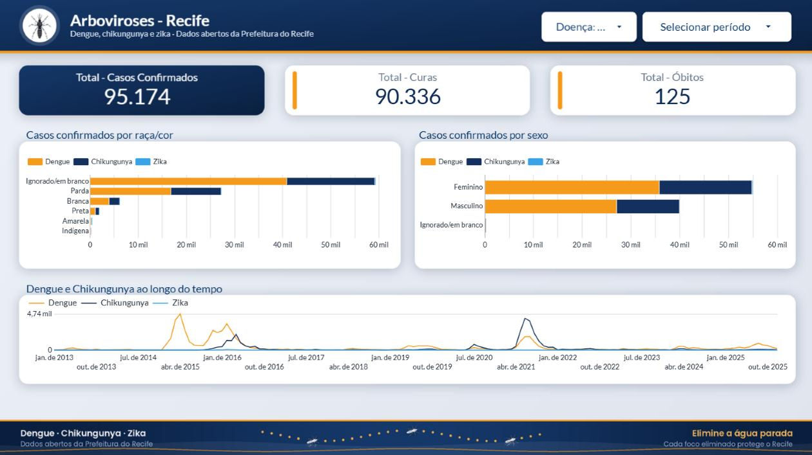
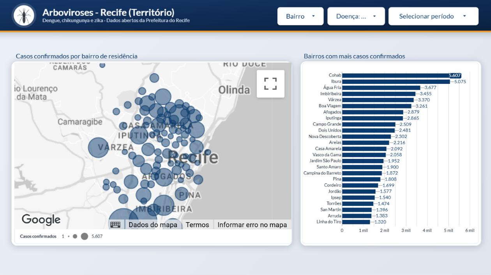
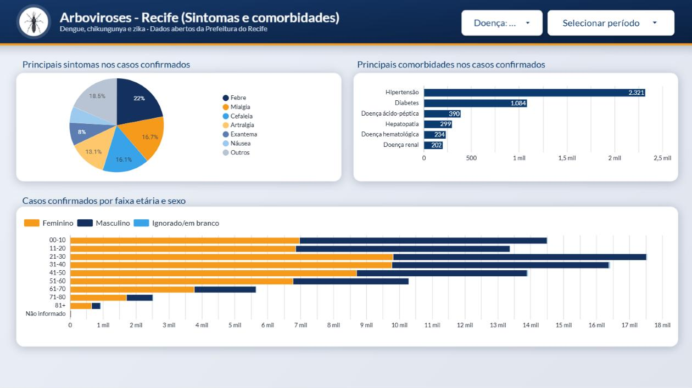
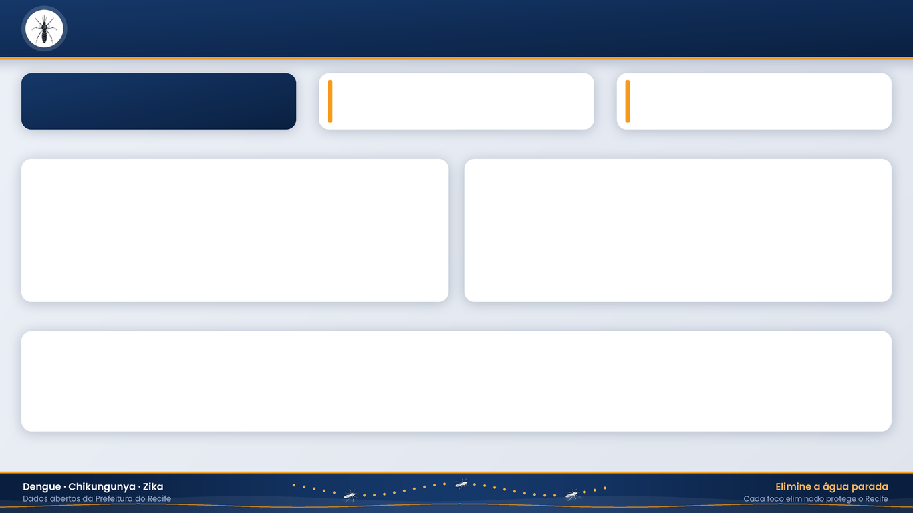
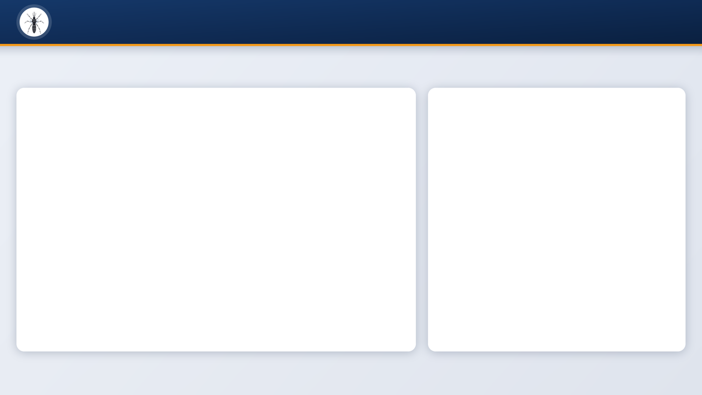

<div align="center">

# Arboviroses no Recife

Dengue, chikungunya e zika em um painel de dados abertos · 2013–2025

Projeto final da disciplina **Gestão de Dados, Informação e Conhecimento**<br>
Bacharelado em Gestão da Informação · UFPE

[**Abrir o painel no Looker Studio →**](https://lookerstudio.google.com/reporting/c47b3fbf-dd57-4ed6-b705-e53ef7b9994b)

</div>

<br>



<br>

<div align="center">

| **95.174** | **90.336** | **125** | **94** |
|:---:|:---:|:---:|:---:|
| casos confirmados | curas | óbitos pelo agravo | bairros |

</div>

## Sobre

O painel transforma os microdados de notificação do SINAN, publicados pela Prefeitura do Recife, em informação para acompanhar as três arboviroses no município: quantos casos foram confirmados, quando e onde eles aconteceram, quem foi atingido e com quais sintomas e comorbidades.

O indicador central é o **caso confirmado** pela classificação final do SINAN. Notificações, casos prováveis e confirmados nunca são somados entre si, e as três bases são combinadas sem misturar registros de naturezas diferentes.

## Páginas

**Visão geral** — totais de confirmados, curas e óbitos, série mensal por doença e perfil por raça/cor e sexo.

**Território** — mapa de bolhas por bairro de residência e ranking dos bairros com mais casos, com filtros de doença, bairro e período.



**Sintomas e comorbidades** — sintomas e doenças preexistentes registrados na ficha de notificação, e casos por faixa etária e sexo.



## Layout

As três páginas seguem o mesmo padrão em tela 16:9 (1366 × 768 px): cabeçalho azul com o logo e os filtros à direita, indicadores e gráficos em cards brancos e, na Visão geral, uma barra de rodapé. Cada página tem um fundo próprio, desenhado como imagem com as mesmas margens e o mesmo cabeçalho. Os gráficos, filtros e textos do Looker Studio ficam por cima, alinhados aos cards.

| Visão geral | Território | Sintomas e comorbidades |
|:---:|:---:|:---:|
|  |  |  |

## Como foi construído

1. **Coleta** — três bases do SINAN (dengue, chikungunya e zika) do Portal de Dados Abertos do Recife, com cerca de 180 mil registros de notificação de residentes do município.
2. **Diagnóstico** — dicionário de dados, regras de confirmação por agravo e por versão da ficha, e identificação de registros de uma doença guardados na base de outra.
3. **Tabelas de apoio** — calendário, padronização de 141 grafias para os 94 bairros oficiais e 8 distritos sanitários, e coordenadas para o mapa.
4. **Modelagem** — campos calculados e mesclas no Looker Studio, que agregam cada base separadamente antes de juntá-las.
5. **Validação** — cada indicador conferido contra os arquivos originais antes de entrar no painel.
6. **Design** — fundos 16:9 gerados em Python (Pillow) e usados como imagem de fundo de cada página, com os componentes posicionados sobre os cards.

Regras, fórmulas e conferências estão em [`docs/metodologia.md`](docs/metodologia.md).

## Para ler os números

- O filtro de período usa a data de notificação.
- Os totais não excluem coinfecções nem duplicidades entre as bases.
- Raça/cor está ignorada ou em branco em 62% dos casos confirmados.
- Na base de zika, sintomas e comorbidades não estão preenchidos.
- 3.970 casos confirmados não têm bairro identificado e ficam fora do mapa.

## Estrutura

```
docs/      metodologia, imagens do painel e fundos das páginas (docs/img/fundos)
dados/     tabelas de apoio usadas nas mesclas
scripts/   geração das tabelas de apoio
```

## Fonte

Prefeitura do Recife — [Casos de Dengue, Zika e Chikungunya](https://dados.recife.pe.gov.br/dataset/casos-de-dengue-zika-e-chikungunya), Portal de Dados Abertos (SINAN).

Ferramentas: Looker Studio, Google Sheets e Python.

<br>

<sub>Samuel Barbosa · Recife, 2026</sub>
